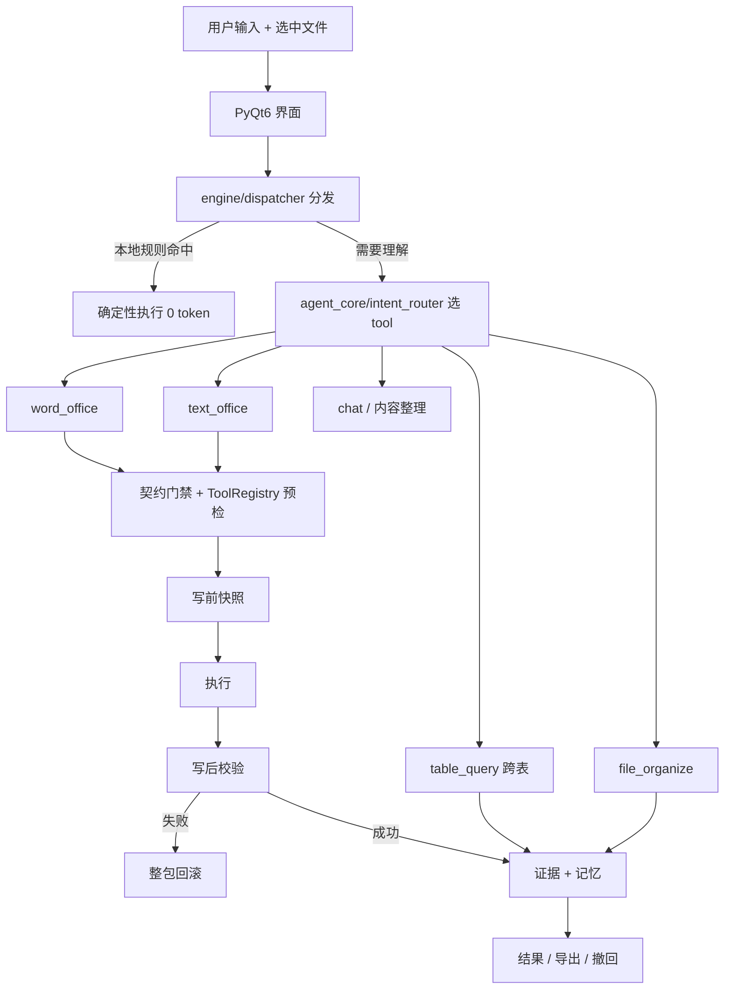

# FileMate

本地桌面助手：用自然语言**整理文件**、**跨多张 Excel 查询**、**编辑 Word**。

> **契约是权威**：算子 / 枚举以 `contracts/versions/*.json` 为准，`pipeline/synth_contract/authority_scan.py` 会扫描漂移。
> **本地优先**：能规则判的不调模型；AI 只出"方案"，本地机械执行 + 校验。

---

## 演示

同一条指令 `把 A型机 替换成 C型机`，在真实 `.docx` 上执行（**不是示意图，是本仓库代码跑出来的**）：

| 改前 | 改后 |
|---|---|
|  |  |

- 只改目标文字，**前后文格式保留**（"甲方是" 仍加粗、"乙方是B型机" 不变）
- 段落 + 表格单元格 **2 处**命中（`applied: 2`）
- 写前备份，执行后落证据（`storage/evidence/`，gzip、脱敏）：

```json
{
  "user_input": "把 A型机 替换成 C型机",
  "tier": "A",
  "ops": 1,
  "before": { "paragraphs": 3, "tables": [{ "rows": 2, "cols": 2, "merged": 0 }] },
  "status": "done",
  "reason": "find_replace"
}
```

> 复现：`python docs/demo/make_demo.py`（素材在 `docs/images/`）。

## 架构一览



三条主线：

- **契约驱动**：算子 / 白名单 / 规则以 `contracts/versions/*.json` 为准，`authority_scan` 扫代码漂移。
- **安全写入**：写前快照 → 执行 → 写后校验 → 失败整包回滚；证据只落本地（gzip、脱敏）。
- **多格式管线**：`office_core` 抽公共流程（扫描/计划/门禁/快照/校验/证据），各格式只写适配器。

---

## 功能

### Excel / 表格

- **跨表查询**：多表筛条件、带关联字段，生成结果表并导出。
- **表格清洗**：识别标题行 / 合并表头 / 多级表头 / 矩阵；认不出先问用户。
- **语义识别**：列名同义 / 包含（本地优先，LLM 兜底默认关）。

### Word

- **写 op**（run/结构级）：`replace` / `insert` / `delete` / `format` / `move` / `tracked_change`，另有 `outline` 与表↔叙述/大纲跨结构。
- **只读**：结构检查、批注/控件/字段列表（无 Key 可走；交叉引用多为 REF/PAGEREF）；书签目前仅有无检测。
- **写前快照**：失败整包还原（事务最小版；非企业级 v4）。
- **危险操作确认**：`delete` / 修订类走确认。
- **记忆**：文件主题 + 术语 + 术语↔锚点 + 生命周期 + 混合召回（FTS5 + LIKE + 向量）；与 Excel 记忆**分开**（有意）。

### 记忆（"小脑"）

- **即时**（当前任务，内存）vs **后台**（跨任务，SQLite）。
- **术语**：规则挖掘（**不调 LLM**）+ 术语↔锚点。
- **召回**：FTS5 + LIKE + 可选向量（`api.embedding_key`）。

---

## 环境

- Python 3.11+（开发用 3.14）
- Windows（PyQt6 桌面）

## 安装

```bash
pip install -r requirements.txt
```

A 级整理（按类型 / 合同归档 / 按日期）**不需要 Key**。查表、改 Word、内容整理才要聊天模型。

## 配置

**推荐：启动后「设置 → 聊天模型设置」**（OpenAI 兼容，如 DeepSeek），写入本地 `config.json`（已被 `.gitignore` 忽略）。记忆纠错 / 跨表查询 Web 走 **「设置 → 本地 Web」**，不必自己找端口。

| 用途 | 配置项 | 说明 |
|---|---|---|
| **聊天模型** | `api_key` + `api.base_url` + `api.model` | 如 DeepSeek |
| **向量召回（可选）** | `api.embedding_key` | SiliconFlow `BAAI/bge-m3`（DeepSeek 无 embedding） |

```json
{
  "api_key": "聊天模型的 Key",
  "params": {
    "api.base_url": "https://api.deepseek.com/v1",
    "api.model": "deepseek-chat",
    "api.embedding_key": ""
  }
}
```

> - **向量可选**：`api.embedding_key` 空 → 召回自动退化为 **FTS5 + LIKE**（不报错）。
> - 旧字段 `zhipu_api_key` 仍兼容（聊天 Key 的旧名）。

## 数据库：SQLite / MySQL

默认 SQLite（`db/filemate.db`，零配置）。业务表（`channels` / `messages` / `logs`）可切 MySQL：

```bash
pip install PyMySQL
export FILEMATE_DB_BACKEND=mysql FILEMATE_DB_HOST=127.0.0.1 \
       FILEMATE_DB_USER=root FILEMATE_DB_PASSWORD=*** FILEMATE_DB_NAME=filemate

python scripts/mysql_init.py                                  # 建库建表
python scripts/mysql_init.py --migrate-sqlite db/filemate.db  # 从 SQLite 导数据
```

- 配置也可写在 `config.json`：`db.backend` / `db.mysql.host` / `db.mysql.port` / `db.mysql.user` / `db.mysql.password` / `db.mysql.database`。
- 记忆库仍用 SQLite（依赖 FTS5 / `sqlite-vec`），**只有业务库支持 MySQL**，这是有意的边界。

## Docker（本地 Web 服务 + MySQL）

桌面 GUI 跑在容器里没有意义，镜像只跑本地 Web 服务，并附带一个 MySQL：

```bash
docker compose up --build
# Web:   http://127.0.0.1:8770/healthz
# MySQL: 127.0.0.1:3307（容器内 3306）
```

`docker-compose.yml` 里的密码仅用于本地开发；容器启动时会自动等 MySQL 就绪并建表。

## 运行

- 双击 `启动FileMate.bat`（或 `启动FileMate.vbs`）
- 或 `python main.py`

## 测试

```bash
pytest tests/ -q
```

> 沙箱环境里 `tmp_path` 可能被拒（`PermissionError`），属**环境限制**，不是代码失败。

## 目录结构

| 目录 | 说明 |
|---|---|
| `ui/` | PyQt6 界面 |
| `engine/` | 意图分发 / 执行器 |
| `agent_core/` | 意图、任务、能力、质检 |
| `ai/` | 模型 HTTP 客户端 + `embed.py` |
| `pipeline/` | 解析、分类、表格处理、契约执行、跨表查询、**`word_office/`** |
| `infra/` `storage/` `db/` | 缓存 / 落库 / 数据库 |
| `export/` | 导出 |
| `web/` | 本地 Web（测试 / 管理） |
| `scripts/` | 开发脚本 |
| `tests/` | 回归测试 |
| `contracts/` | 契约库（权威定义） |
| `fixtures/` | 测试夹具 |
| **`docs/`** | **权威文档**：架构 / 规格 / 状态 / 可优化 |

## 文档

| 文件 | 内容 |
|---|---|
| `docs/architecture.md` | 架构（A–E + op 两维度；记忆；复用原则） |
| `docs/specs/word_office_spec.md` | Word 接入设计（**权威规格**） |
| `docs/spec_status.md` | 规格落地状态（写 op + 跨结构 + 批注只读） |
| `docs/optimizations.md` | 可优化 + 技术弊端（backlog） |

## 说明

- 本仓库**只含产品源码与权威文档（`docs/`）**：私有表、本地 `acceptance/`、草稿旁路**不入库**（见 `.gitignore`）。
- **不改原文件**：Word/Excel 操作**写前备份**，失败**回滚**。
- 依赖唯一清单：`requirements.txt`（勿再在根目录放爬虫/草稿目录）。
